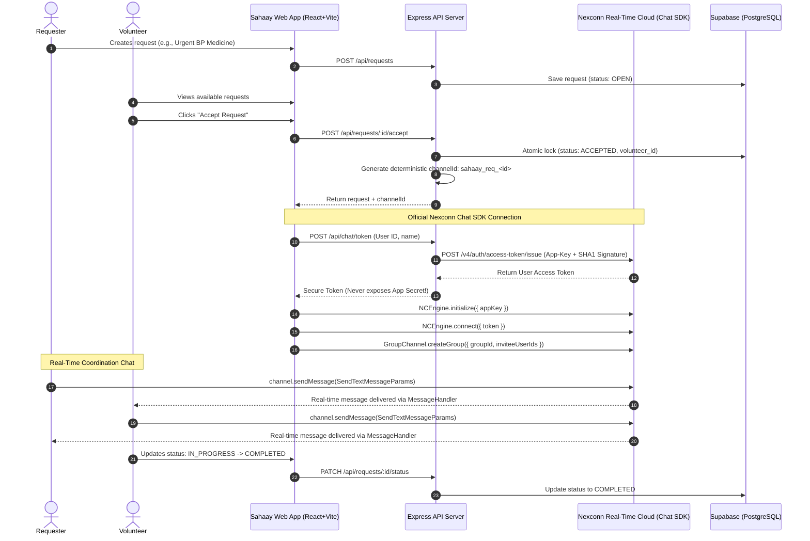

# Sahaay 🤝
> **Connecting people. Empowering communities.**  
> *Nexconn Hackathon Build Challenge 2026 — Track: Humanitarian & Social Good*

[](https://docs.nexconn.ai/chatsdk-web)
[](https://react.dev/)
[](https://www.typescriptlang.org/)
[](https://vitejs.dev/)
[](https://tailwindcss.com/)
[](https://supabase.com/)

---

## 📌 Executive Summary

People who need assistance (senior citizens, sick individuals, isolated families) frequently struggle to find reliable volunteer help. When requests are posted in massive community group chats, messages quickly get buried, coordination breaks down, and requesters cannot track who is helping.

**Sahaay** solves this by assigning every single assistance request its own dedicated, atomic real-time coordination room powered by the **official Nexconn Chat Web SDK** (`@nexconn/chat` and `@nexconn/engine`).

> **Advisory Disclaimer:** Sahaay is a humanitarian community coordination platform connecting neighbors with volunteers. It is **not** an emergency response service (in life-threatening emergencies, dial 112 / 911).

---

## 🏗️ Architecture & Nexconn Integration Flow



---

## 💬 Mandatory Nexconn Chat SDK Implementation

Sahaay implements actual Nexconn communication using official packages and official APIs:

1. **Packages Used**:
   - `@nexconn/engine`: Core protocol, WebSockets connection, and authentication layer.
   - `@nexconn/chat`: Channel management (`GroupChannel`, `BaseChannel`), messaging (`SendTextMessageParams`), and event handlers (`MessageHandler`, `ConnectionStatusHandler`).

2. **Security & App Secret Isolation**:
   - `NEXCONN_APP_KEY`: Public client identifier safe for frontend initialization.
   - `NEXCONN_APP_SECRET`: **Never** bundled in frontend code. Kept strictly on the backend.
   - Request signature: `SHA1(NEXCONN_APP_SECRET + Nonce + Timestamp)` used to sign server-to-server token requests.
   - Backend endpoint: `POST /api/chat/token` authenticates identity before issuing token.

3. **Core SDK Invocations in Code**:
   ```ts
   // 1. Initialization (frontend/src/services/nexconnChat.ts)
   NCEngine.initialize({ appKey });

   // 2. Real-Time Connection
   const result = await NCEngine.connect({ token });

   // 3. Dedicated Group Channel Creation
   await GroupChannel.createGroup({
     groupId: channelId,
     groupName: request.title,
     inviteeUserIds: [requesterId, volunteerId]
   });

   // 4. Sending Text Messages
   const channel = new GroupChannel(channelId);
   await channel.sendMessage(new SendTextMessageParams({ text }));

   // 5. Message History Query
   const query = BaseChannel.createMessagesQuery({
     channelIdentifier: new GroupChannelIdentifier(channelId),
     pageSize: 50
   });
   const history = await query.loadNextPage();

   // 6. Real-Time Listener
   NCEngine.addMessageHandler('sahaay_msg_handler', new MessageHandler({
     onMessageReceived: ({ messages }) => { ... }
   }));
   ```

---

## ♿ Accessibility First

Sahaay was designed for community members of all ages and abilities:
- **Large-Font Mode**: 1-click toggle (`A+` icon) increases typography size across headers, labels, form controls, and chat bubbles.
- **High-Contrast Mode**: 1-click toggle (`◐` icon) activates high-contrast color styling for visually impaired users.
- **Voice-to-Text Dictation**: Integrated Web Speech API microphone dictation on request descriptions and chat inputs, with graceful fallback for unsupported browsers.
- **Responsive Mobile Layout**: Tested for smartphones and touch devices.

---

## 🚀 Quick Start Guide

### Prerequisites
- Node.js (v18+ recommended)
- npm or pnpm

### 1. Clone the Repository
```bash
git clone https://github.com/your-username/sahaay.git
cd sahaay
```

### 2. Configure Environment Variables

**Backend (`backend/.env`):**
```bash
cp backend/.env.example backend/.env
```
Edit `backend/.env`:
```env
PORT=5000
NODE_ENV=development

# Nexconn Credentials (https://console.nexconn.ai/)
NEXCONN_APP_KEY=your_nexconn_app_key
NEXCONN_APP_SECRET=your_nexconn_app_secret
NEXCONN_PRIMARY_API_DOMAIN=https://api.nexconn.ai

# Supabase (Optional - in-memory fallback enabled by default)
SUPABASE_URL=https://your-project.supabase.co
SUPABASE_SERVICE_ROLE_KEY=your_service_role_key
```

**Frontend (`frontend/.env`):**
```bash
cp frontend/.env.example frontend/.env
```
Edit `frontend/.env`:
```env
VITE_API_URL=http://localhost:5000
VITE_NEXCONN_APP_KEY=your_nexconn_app_key
```

### 3. Install Dependencies & Build
```bash
# Install backend and frontend dependencies
npm --prefix backend install
npm --prefix frontend install

# Build both applications
npm run build
```

### 4. Run the Project
```bash
# Terminal 1: Run Backend API
npm run dev:backend
# -> Runs on http://localhost:5000

# Terminal 2: Run Frontend Web App
npm run dev:frontend
# -> Runs on http://localhost:5173
```

---

## 🧪 2-Session Live Demo Script (For Judges)

To test the complete end-to-end multi-user workflow:

1. **Browser Session 1 (Requester):**
   - Open `http://localhost:5173` in Google Chrome.
   - Click the user avatar in the top right and select **Anjali Sharma (Requester)**.
   - Click **"Request Help"**.
   - Select **Medicine Delivery**, enter title *"Urgent BP & Diabetes Medication"*, enter location *"Indiranagar"*, priority *"Urgent"*.
   - Click **"Publish Assistance Request"**.
   - Notice the status is **OPEN** and waiting for a volunteer.

2. **Browser Session 2 (Volunteer):**
   - Open `http://localhost:5173` in an **Incognito Window** or separate browser.
   - Select **Rahul Verma (Volunteer)** from the top-right persona switcher.
   - Go to **"Volunteer Feed"**.
   - You will see Anjali's medicine delivery request at the top of the feed!
   - Click **"Accept & Open Chat"**.

3. **Real-Time Nexconn Chat Experience:**
   - Both browser windows will now display the dedicated coordination room!
   - Notice the green badge: **"Nexconn SDK Live"**.
   - Type a message in Session 2: *"Hello Anjali, I am on 100ft road and heading to Apollo Pharmacy now!"*
   - Watch the message appear instantly in Session 1 in real time via the Nexconn Web SDK.
   - Try the **Voice-to-Text** microphone icon in Session 1 to speak a reply!

4. **Lifecycle Status Updates:**
   - Volunteer clicks **"Start Assistance"** → Status advances to `IN_PROGRESS` in both sessions.
   - When delivered, click **"Complete Assistance"** → Status advances to `COMPLETED`.

---

## 🗄️ Database Schema (Supabase / PostgreSQL)

The database schema is located in `supabase/schema.sql`.

Key tables:
- `users`: `id`, `name`, `email`, `role` ('requester' | 'volunteer'), `location`, `phone`, `avatar_url`, `bio`.
- `assistance_requests`: `id`, `requester_id`, `title`, `description`, `category`, `location`, `priority`, `status`, `accepted_volunteer_id`, `nexconn_channel_id`, `created_at`, `completed_at`.

Row Level Security (RLS) policies and optimistic locking prevent race conditions when multiple volunteers attempt to claim the same request simultaneously.

---

## 🚢 Production Deployment

- **Frontend (Vercel)**:
  - Framework Preset: `Vite`
  - Root Directory: `frontend`
  - Build Command: `npm run build`
  - Output Directory: `dist`
  - Environment Variables: `VITE_API_URL`, `VITE_NEXCONN_APP_KEY`.

- **Backend (Render / Railway / Fly.io)**:
  - Root Directory: `backend`
  - Build Command: `npm run build`
  - Start Command: `npm start`
  - Environment Variables: `PORT`, `NEXCONN_APP_KEY`, `NEXCONN_APP_SECRET`, `CLIENT_URL`.

---

## 🏆 Nexconn Hackathon Judging Criteria Alignment

| Criteria | Weight | How Sahaay Delivers |
|---|---|---|
| **Completeness & UX** | **50%** | Polished, accessible UI with large font mode, high contrast, voice-to-text dictation, responsive design, 2-session persona testing, zero broken workflows. |
| **Innovation & Scenario Value** | **30%** | Replaces chaotic community messaging groups with 1:1 dedicated, atomic Nexconn group channels. Solves real-world humanitarian volunteer coordination for seniors and vulnerable neighbors. |
| **Business & Growth Potential** | **20%** | Highly scalable across RWAs, NGOs, city municipalities, disaster relief groups, and neighborhood welfare associations. |

---

## 📄 License

This project is licensed under the [MIT License](LICENSE).
Built with ❤️ for the **Nexconn Build Challenge 2026**.
